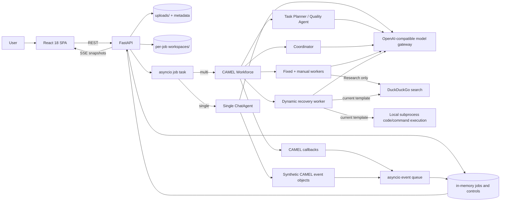
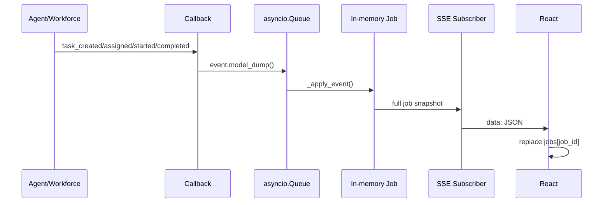
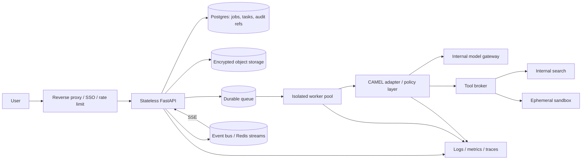

# Agent Webapp — Güncel Mimari Analiz

> İncelenen sürüm: `clean-rebuild` / `91902a9`
> İnceleme tarihi: 2026-07-29
> Amaç: Direktör sunumu, teknik soru-cevap hazırlığı ve üretimleşme yol haritası

## 1. Yönetici özeti

Bu repo, kullanıcıdan bir görev ve isteğe bağlı dokümanlar alıp görevi tek bir
LLM agent'ına veya CAMEL-AI tabanlı çok-agent'lı bir Workforce'a çalıştıran bir
demo/pilot uygulamasıdır.

Mevcut sistemin en doğru kısa tanımı şudur:

- React/Vite istemci, FastAPI backend'e REST ve Server-Sent Events (SSE) ile
  bağlanır.
- Backend, job'ları aynı proses içindeki Python sözlüklerinde tutar ve her job
  için bir `asyncio` task başlatır.
- Single Agent modu tek bir `ChatAgent.astep()` çağrısı yapar.
- Workforce modu CAMEL'in `AUTO_DECOMPOSE` akışını kullanır: Task Planner
  görevi dinamik alt görevlere böler, Coordinator bunları worker'lara atar,
  worker'lar çalışır, Task Agent kalite kontrol ve recovery kararı verir.
- Sabit worker havuzu Research, Document, Review ve Outline agent'larından
  oluşur. Kullanıcı yeni agent ekleyebilir; CAMEL recovery sırasında ayrıca
  dinamik worker üretebilir.
- Model erişimi tek bir OpenAI-compatible adapter üzerinden yapılır. Kodun
  varsayılanı yerel Ollama'dır; geliştirici `.env` dosyası başka bir gateway'e
  yönlendirebilir.
- Upload katmanı güçlü ZIP sınırları uygular ve job'a özel bir workspace
  oluşturur. Ancak kodda tanımlı read-only workspace tool'ları hiçbir agente
  bağlanmamıştır; agent'lar yalnız prompt'a eklenen sınırlı preview'ları görür.

Mimari iyi ayrılmış bir demo çekirdeğine sahiptir; fakat bugünkü haliyle
üretim sistemi değildir. En kritik farklar kimlik doğrulama, kalıcı job
saklama, ayrı worker/queue katmanı, concurrency kontrolü, güvenli tool
sandbox'ı, test/CI ve gerçek air-gap paketlemesidir.

## 2. Sistem bağlamı

Bu diyagramdaki `EXEC` özellikle önemlidir: proje README'sindeki "terminal
execution registered değil" ifadesinin aksine, dinamik worker şablonuna
`CodeExecutionToolkit` eklenmiştir.

## 3. Repo ve modül sorumlulukları

| Katman | Dosya | Gerçek sorumluluk |
|---|---|---|
| HTTP sınırı | `backend/main.py` | Upload, job API, SSE, cancellation, export, in-memory state |
| CAMEL adapter | `backend/camel_service.py` | Single Agent ve Workforce kurulum/çalıştırma |
| Model adapter | `backend/model_config.py` | OpenAI-compatible model factory ve usage wrapper |
| Event adapter | `backend/workforce_callback.py` | CAMEL event'lerini `asyncio.Queue`'ya taşır |
| Tool audit | `backend/tool_call_log.py` | Gerçek search çağrılarını memory + JSONL'e kaydeder |
| Search uyumluluğu | `backend/duckduckgo_search.py` | CAMEL'in eski import/API'sini `ddgs` paketine çevirir |
| Workspace güvenliği | `backend/workspace.py` | ZIP doğrulama, job izolasyonu, bounded preview, read-only helper'lar |
| Doküman export | `backend/document_export.py` | DOCX ve PDF üretimi |
| Frontend state | `frontend/src/App.jsx` | Hydration, upload, submit, SSE, cancellation, navigation |
| API client | `frontend/src/api.js` | REST çağrıları ve binary export |
| Job normalizasyonu | `frontend/src/stages.js` | Task/status/output/final-answer türetme |
| Ana task UI | `frontend/src/components/TaskFlowView.jsx` | Running + result + export akışı |

### Tasarım açısından iyi sınırlar

- `main.py`, CAMEL sınıflarına doğrudan bağımlı iş mantığı taşımıyor;
  `camel_service.py` bir anti-corruption/adapter katmanı görevi görüyor.
- Model seçimi `model_config.py` içinde merkezî; provider değiştirmek için
  agent kodunun değişmesi gerekmiyor.
- Frontend, task sayısını veya worker sayısını sabit kabul etmiyor; event'lerden
  dinamik plan oluşturuyor.
- Single ve multi yolları aynı event/state sözleşmesine adapte edildiği için UI
  iki ayrı uygulamaya bölünmemiş.

## 4. Uçtan uca request yaşam döngüsü

### 4.1 Uygulamanın açılması

1. `App` mount olduğunda `GET /jobs` ve `GET /workers` çağrılır.
2. Job'lar `created_at` ile sıralanır ve React state'inde `job_id` ile
   indekslenir.
3. Aktif job varsa `/jobs/{job_id}/events` için bir `EventSource` açılır.
4. Backend yeniden başlamışsa `GET /jobs` boş döner; job geçmişi kalıcı
   değildir.

Kaynaklar:

- `frontend/src/App.jsx:78-208`
- `backend/main.py:492-496`
- `backend/main.py:890-929`

### 4.2 Upload ve workspace

1. Frontend extension, kaynak sayısı, tekil 20 MiB ve toplam 50 MiB limitini
   kontrol eder.
2. `POST /uploads` backend'de aynı kontrolleri tekrarlar.
3. Raw dosya `backend/uploads/` altında UUID adıyla saklanır.
4. PDF, DOCX, XLSX, CSV ve TXT için metin çıkarılır; ZIP için arşiv incelenir.
5. Metadata JSON ve extracted-text sidecar dosyası diske yazılır.
6. Job submit edilince kaynaklar `backend/workspaces/{job_id}/` altına
   kopyalanır/açılır.
7. En fazla 60.000 karakterlik bounded workspace preview, kullanıcı prompt'una
   eklenir.

Önemli ayrım: `ReadOnlyWorkspaceTools` üç güvenli fonksiyon tanımlar
(`list_files`, `read_text_file`, `search_text`) fakat current checkout'ta bu
sınıf hiç instantiate edilmez ve hiçbir `ChatAgent`'a verilmez. README'deki
"Only the Tool Agent receives workspace access" ifadesi bugünkü kod için
doğru değildir.

Kaynaklar:

- `backend/main.py:77-320`
- `backend/main.py:698-778`
- `backend/workspace.py:14-544`
- `frontend/src/App.jsx:19-30`
- `frontend/src/App.jsx:283-385`

### 4.3 Job yaratma

1. `POST /run-pipeline` topic, mode ve upload ID'lerini alır.
2. Job kaydı `_JOBS` içine `queued` olarak yazılır.
3. `_JobControl`, usage tracker ve tool recorder yaratılır.
4. `asyncio.create_task(_run_job(...))` çağrılır ve API hemen `job_id` döner.
5. Ayrı bir process, durable queue veya external worker yoktur.

Kaynak: `backend/main.py:722-778`

### 4.4 Event ve canlı güncelleme

Multi Agent modunda event'ler gerçek `WorkforceCallback` event'leridir.
Single Agent modunda aynı CAMEL event model sınıfları uygulama tarafından
sentetik olarak üretilir. SSE delta değil, her event'te tam job snapshot'ı
taşır.

Kaynaklar:

- `backend/workforce_callback.py:1-65`
- `backend/camel_service.py:315-382`
- `backend/main.py:508-620`
- `frontend/src/App.jsx:166-208`

## 5. Single Agent ve Workforce farkı

| Boyut | Single Agent | Workforce |
|---|---|---|
| Başlangıç varsayılanı | Evet | Hayır |
| Model çağrısı | Normalde 1 | Planner + coordinator + worker + quality/recovery nedeniyle çok |
| Planlama | Yok | LLM tabanlı dinamik decomposition |
| Atama | Yok | Coordinator agent |
| Worker | `Assistant` | 4 sabit + manual + olası dynamic |
| Kalite kontrol | Uygulama düzeyinde yok | CAMEL Task Agent |
| Tool | Yok | Research search; dynamic worker search/code/thinking |
| Latency/maliyet | Düşük | Daha yüksek ve değişken |
| En iyi kullanım | Basit doğrudan görev | Paralelleşebilen/uzmanlaşan karmaşık görev |

### 5.1 Single Agent akışı

`run_single_agent()` bir `ChatAgent` yaratır ve `astep(content)` çalıştırır.
Sonucu `TaskState.DONE` olarak işaretler. Boş cevap için ayrıca kalite veya
retry politikası yoktur.

### 5.2 Workforce akışı

Current code sabit dört adımlı pipeline kullanmaz. CAMEL'in varsayılan
`WorkforceMode.AUTO_DECOMPOSE` modu kullanılır:

1. Root task için `TaskCreatedEvent` yayınlanır.
2. Task Planner root task'ı dinamik subtasks'a böler.
3. Coordinator, tüm pending task'ları uygun worker'lara atar ve dependency
   listeleri üretir.
4. Dependency'si hazır olan task'lar channel'a gönderilir; bağımsız task'lar
   paralel çalışabilir.
5. Worker sonucu structured `TaskResult` olarak parse edilir.
6. Task Agent sonucu kalite açısından değerlendirir.
7. Gerekiyorsa retry, replan, reassign, decompose veya create-worker recovery
   uygulanır.
8. Root result, subtask sonuçlarının birleştirilmiş metnidir.

Kaynaklar:

- `backend/camel_service.py:207-308`
- `backend/vendor/camel-source/camel/societies/workforce/workforce.py:285-304`
- `backend/vendor/camel-source/camel/societies/workforce/workforce.py:2167-2285`
- `backend/vendor/camel-source/camel/societies/workforce/workforce.py:3927-4145`

### 5.3 Worker havuzu

Sabit worker'lar:

- Research Agent: güncel/doğrulanabilir bilgi için DuckDuckGo search.
- Document Agent: yazılı içerik üretimi, toolsuz.
- Review Agent: doğruluk, açıklık ve bütünlük kontrolü, toolsuz.
- Outline Agent: yapı ve bölümleme, toolsuz.

Manual worker'lar session-scoped ve memory'dedir; backend restart'ında silinir.
Çalışmakta olan Workforce'a eklenmezler, sonraki job için yeni Workforce
kurulurken register edilirler.

Dynamic worker template'i şunlara sahiptir:

- DuckDuckGo search
- `CodeExecutionToolkit.execute_code`
- `CodeExecutionToolkit.execute_command`
- Thinking toolkit

`CodeExecutionToolkit` varsayılan olarak `subprocess` sandbox adını kullanır,
`require_confirm=False` durumundadır ve OS command çalıştırabilir. Bu gerçek
bir güvenlik sınırı değildir; üretim öncesi kaldırılmalı veya izole sandbox/tool
broker ile değiştirilmelidir.

Kaynaklar:

- `backend/camel_service.py:34-123`
- `backend/camel_service.py:240-300`
- `backend/vendor/camel-source/camel/toolkits/code_execution.py:33-119`
- `backend/vendor/camel-source/camel/toolkits/code_execution.py:130-179`

## 6. Model ve tool entegrasyonu

### 6.1 Model adapter

`MODEL_BASE_URL`, `MODEL_NAME` ve `MODEL_API_KEY`, CAMEL'in
`OPENAI_COMPATIBLE_MODEL` backend'ini kurar. Kod default'u:

- Base URL: `http://localhost:11434/v1`
- Model: `qwen2.5:3b`
- API key placeholder: `ollama`
- `max_tokens`: 4096

Geliştirici makinesindeki ignored `.env`, bu default'u harici bir gateway ve
farklı modelle override ediyor. Bu, adapter'ın taşınabilirliğini kanıtlar; aynı
zamanda "air-gapped" deployment iddiasının environment/policy ile ayrıca
garanti edilmesi gerektiğini gösterir.

### 6.2 Usage telemetry

Her model backend'i `_UsageTrackingModel` ile sarılır. Provider usage nesnesi
verirse input/output/total token ve çağrı sayısı job'a eklenir.

Sınırlar:

- Provider usage dönmezse gerçek bir model çağrısı yapılmış olsa bile
  `model_call_count` artmaz.
- `estimated_cost_usd` hiçbir yerde hesaplanmıyor/doldurulmuyor.
- `total_duration_seconds` usage içine yazılmıyor; frontend job duration'a
  fallback ediyor.

### 6.3 Tool audit

Research search fonksiyonu wrapper ile gerçek args/result/error bilgisi olarak
hem job memory'sine hem `backend/logs/tool_calls.jsonl` dosyasına yazılır.
Bu, agent'ın "arama yaptım" iddiasından bağımsız kanıt sağlar.

Sınırlar:

- Kayıtta worker/agent ID yoktur.
- JSONL rotasyonu, TTL, redaction ve encryption yoktur.
- Dynamic worker'ın code/command tool çağrıları bu recorder ile sarılmamıştır.

## 7. Frontend mimarisi

Frontend tek React root'u ve local component state kullanır; Redux veya server
state kütüphanesi yoktur.

Önemli davranışlar:

- Startup hydration REST ile yapılır.
- Aktif her job için bir EventSource açılır.
- SSE mesajı geldiğinde job snapshot bütünü replace edilir.
- Running ve Results ayrı tab değil, tek `TaskFlowView` içinde sürekli bir
  akıştır.
- Markdown/TXT export browser'da, DOCX/PDF export backend'de üretilir.
- Feedback butonları yalnız local state'tir; backend'e gönderilmez.
- Final answer seçimi frontend'dedir: explicit final output yoksa dependency
  graph'taki leaf task output'ları seçilir; son çare root `job.result`tır.

Bu nedenle "Final synthesized answer" başlığı her zaman gerçek bir synthesis
agent'ı çalıştığı anlamına gelmez. Uygulama tarafında zorunlu bir synthesis
stage yoktur.

### UI ile backend arasındaki güncel isim sapması

Home ekranındaki dekoratif agent satırı Research, Document, Review,
Synthesis ve Tool Agent gösterir. Backend'in gerçek sabit pool'u Research,
Document, Review ve Outline'dır. Right Panel `/workers` verisini kullandığı
için daha doğrudur; Home satırı sunumdan önce güncellenmelidir.

Kaynaklar:

- `frontend/src/components/HomeView.jsx:25-31`
- `frontend/src/components/RightPanel.jsx:112-225`
- `frontend/src/stages.js:103-221`
- `frontend/src/components/TaskFlowView.jsx:50-346`

## 8. API yüzeyi

| Method | Endpoint | Amaç |
|---|---|---|
| POST | `/upload` | Legacy tek dosya upload |
| POST | `/uploads` | En fazla 10 kaynak upload |
| POST | `/run-pipeline` | Single veya multi job başlat |
| GET | `/jobs` | Tüm in-memory job snapshot'ları |
| GET | `/jobs/{id}` | Tek job snapshot'ı |
| GET | `/jobs/{id}/events` | SSE canlı snapshot stream |
| POST | `/jobs/{id}/cancel` | Cooperative cancel |
| POST | `/jobs/{id}/export/{docx\|pdf}` | Görünen final metni dokümana çevir |
| GET | `/workers` | Fixed + manual worker pool |
| POST | `/workers` | Session-scoped manual worker ekle |

API'de authentication, authorization, tenant ayrımı, rate limit ve health
endpoint yoktur.

## 9. Güçlü yanlar

1. **Provider abstraction:** OpenAI-compatible model gateway ile model değişimi
   agent kodundan ayrılmış.
2. **Single/multi seçimi:** Basit işlere gereksiz orchestration maliyeti
   bindirilmiyor.
3. **Gerçek event entegrasyonu:** Multi-agent UI sahte timer değil, CAMEL
   lifecycle event'lerini gösteriyor.
4. **Ground-truth tool logging:** Agent metnine güvenmek yerine gerçek search
   çağrısı kaydediliyor.
5. **ZIP güvenliği:** Path traversal, symlink, encryption, duplicate path,
   unsupported/binary file ve zip-bomb benzeri boyut/sayı riskleri sınırlandırılmış.
6. **Job workspace izolasyonu:** Her job ayrı dizine kopyalanıyor.
7. **Tam pinned backend dependencies:** Air-gap hedefi için Python 3.11 Windows
   wheel bundle'ı ve CAMEL source'u repoda.
8. **İyi kullanıcı akışı:** Submit sonrası anlık stub, SSE progress, cancel ve
   dört export formatı.

## 10. Üretim hazırlık riskleri

| Öncelik | Risk | Bugünkü etki | Öneri |
|---|---|---|---|
| P0 | Dynamic worker local command execution | Prompt injection OS komutu çalıştırabilir | Toolkit'i kaldır; sandboxed tool broker + allowlist |
| P0 | Auth/authorization yok | Job/result/worker API'leri herkese açık | SSO/OIDC, tenant ve RBAC |
| P0 | Harici model/search ile air-gap iddiası çelişiyor | Veri egress ve data residency riski | Internal model gateway; internal search veya search kapalı |
| P0 | Dev env'de `ddgs` ve `reportlab` eksik | Search ve PDF export runtime'da fail | Rebuild venv; startup dependency smoke test |
| P1 | Job state yalnız memory'de | Restart'ta geçmiş kaybolur; multi-worker Uvicorn çalışmaz | Postgres + durable queue/state |
| P1 | Ayrı worker/queue yok | Unlimited job concurrency API prosesini tüketir | Queue + worker pool + per-user quota/backpressure |
| P1 | CAMEL bazı planner/coordinator/quality çağrılarını sync yapıyor | Multi mode event loop'u bloklayabilir | Worker process'e taşı veya thread isolation |
| P1 | Upload parsing async endpoint içinde sync/CPU-heavy | Büyük PDF/XLSX API/SSE'yi bloklayabilir | Parsing worker + time/memory limits + malware scan |
| P1 | Upload/workspace/log retention yok | Disk büyür, hassas veri kalır | TTL cleanup, quota, encryption, audit policy |
| P1 | Automated test/CI yok | Regression ve demo riski | Unit/integration/e2e + CI gates |
| P1 | Overall job timeout yok | Job/provider çağrısı uzun süre asılı kalabilir | App-level deadline + provider timeout/retry policy |
| P2 | SSE queue'ları unbounded ve heartbeat yok | Slow client memory/reconnect riski | Bounded stream buffer + heartbeat |
| P2 | Cost telemetry boş | Maliyet yönetimi yapılamaz | Pricing policy/gateway cost attribution |
| P2 | Frontend offline bundle yok | Tam air-gap build tekrarlanamaz | Prebuilt assets veya npm offline cache |
| P2 | Health/readiness/deployment manifest yok | Operasyon ve rollout zor | `/healthz`, `/readyz`, service/container manifests |

## 11. Güvenlik modeli

### Bugün gerçekten uygulanan kontroller

- `.env` ve runtime verileri gitignore'dadır.
- CORS yalnız localhost dev origin'lerine izin verir.
- Dosya extension ve boyut limitleri frontend/backend'de vardır.
- ZIP path traversal, symlink, encryption ve duplicate path reddedilir.
- Workspace path'leri root altında resolve edilir.
- Read-only workspace helper'ları path boundary uygular.

### Uygulanmayan veya eksik kontroller

- Kullanıcı/tenant kimliği yok.
- API authorization yok.
- Upload malware scanning/content disarm yok.
- Prompt injection defense ve tool policy engine yok.
- Dynamic subprocess gerçek sandbox değildir.
- Secrets manager yok; env dosyası kullanılıyor.
- Network egress allowlist yok.
- Data classification/redaction yok.
- Audit retention/immutability yok.
- Dependency hash/SBOM/vulnerability gate yok.

## 12. Ölçeklenebilirlik ve hata davranışı

### Neden birden fazla backend replica bugün çalışmaz?

Job ve subscriber state'i process memory'sindedir. Bir replica'da yaratılan
job için başka replica `404` döner. SSE connection aynı replica'ya gitse bile
restart job'ı kaybettirir. Çözüm sticky session değil, external shared state
ve durable execution queue'dur.

### Concurrency

Her submit doğrudan bir `asyncio` task üretir. Global/per-user semaphore,
queue capacity veya provider rate limiter yoktur. Workforce ayrıca birden
fazla hazır subtask'ı paralel worker'lara gönderebilir. Bu demo için hızlıdır;
yük altında kaynak ve maliyet kontrolü sağlamaz.

### Cancellation

Cancellation cooperative'tir:

- Yeni task scheduling durdurulur.
- Aktif provider çağrısı veya Python fonksiyonu zorla öldürülemez.
- Single mode'da Workforce olmadığı için çağrı tamamlanana kadar devam eder;
  job statüsü yine `cancelled` kalır.

### Timeout

Uygulama seviyesinde total job deadline yoktur. CAMEL'in task bekleme timeout'u
varsayılan 600 saniyedir; provider client timeout/retry ayarları explicit
değildir.

## 13. Gözlemlenebilirlik

### Mevcut

- Job duration
- Provider-reported token usage
- Model call wrapper
- Task creation/assignment/start/completion event'leri
- Timing logger ile decomposition/assignment/execution breakdown
- Search tool args/result/error JSONL audit
- UI'da per-task state, worker ve usage

### Eksik

- Metrics endpoint ve dashboard
- Distributed tracing/correlation ID standardı
- Structured merkezi log sink
- Error budget/SLO
- Provider latency ve retry breakdown
- Queue depth/concurrency
- Cost attribution
- Tool-call-to-worker attribution
- Retention/redaction politikası

## 14. Test ve doğrulama durumu

2026-07-29 tarihinde model çağrısı yapmadan şu kontroller uygulandı:

- Backend Python dosyaları `py_compile`: **geçti**
- FastAPI app import ve route discovery: **geçti**
- `GET /jobs`, `GET /workers` TestClient smoke: **geçti**
- Frontend `npm run build`: **geçti**
- Python 3.11 ortamı `pip check`: **geçti**
- DOCX export magic/header smoke: **geçti**
- Valid ZIP inspection: **geçti**
- ZIP `../` traversal rejection: **geçti**
- PDF export dependency smoke: **kaldı** (`reportlab` dev venv'de eksik)
- Search shim import smoke: **kaldı** (`ddgs` dev venv'de eksik)

`pip check` son iki eksik paketi raporlamaz; bu komut requirements
completeness değil, kurulu distribution'ların kendi dependency tutarlılığını
kontrol eder.

Repo içinde gerçek automated test suite, frontend test/lint script'i veya CI
workflow yoktur. `backend/test_upload.py` çalışan server'a manuel istek atan
bir smoke script'idir.

## 15. Sunumda doğru ifade edilmesi gereken sınırlar

| Yanlış veya eksik ifade | `clean-rebuild` için doğru ifade |
|---|---|
| "Dört agent sırayla çalışan sabit bir pipeline var" | Task Planner dinamik task graph üretir; Coordinator uygun worker'ı seçer |
| "Yalnız Tool Agent workspace tool'larına erişir" | Workspace tool sınıfı var fakat şu an hiçbir agente bağlı değil |
| "Agent'ların terminal erişimi yok" | Fixed worker'larda yok; dynamic worker template'inde local command execution var |
| "Sistem doğrudan air-gapped çalışıyor" | Paketleme hedefi air-gap'tir; model ve search endpoint'leri deployment policy ile internal yapılmalıdır |
| "Synthesis ve Tool Agent sabit pool'da" | Backend pool'u Research, Document, Review ve Outline'dır |

Bu ifadeler sunumda doğru kurulmalıdır; aksi halde direktörün repo üzerinden
sorduğu sorularla anlatım çelişir.

## 16. Hedef üretim mimarisi

Temel prensipler:

- API prosesinde model orchestration çalıştırma.
- Job/task state'ini process memory'sinde tutma.
- Agent'a doğrudan OS tool verme.
- Model/search egress'ini policy dışına çıkarma.
- Event'i UI state'i ile aynı process'e bağlama.
- Upload ve audit verisine açık uçlu retention uygulama.

## 17. Önerilen yol haritası

### Faz 0 — Demo güvence, 1 gün

- Dev venv'i requirements ile yeniden kur; search ve PDF smoke çalıştır.
- Dynamic worker'dan code/command toolkit'i kaldır.
- README, Home agent isimleri ve sunumu çalışan kodla hizala.
- `.env.example`, start komutları ve demo runbook ekle.
- Önceden hazırlanmış iki demo senaryosunu uçtan uca kaydet.

### Faz 1 — Kontrollü pilot, 2–4 hafta

- OIDC/SSO ve tenant-aware authorization.
- Postgres job/task persistence.
- Durable queue ve bounded worker concurrency.
- Upload TTL/cleanup, AV scan ve size/time guard'ları.
- Internal model gateway ve egress policy.
- Unit/integration/e2e test + CI.
- App-level timeout, retry ve idempotency.

### Faz 2 — Üretim, 4–8 hafta

- HA event stream, reconnect/cursor modeli.
- Sandbox tool broker ve fine-grained allowlist.
- Evaluation dataset, hallucination/quality ölçümü, approval gates.
- Metrics/tracing/SLO/cost dashboards.
- SBOM, signed artifacts, dependency vulnerability gates.
- Data retention, redaction ve immutable audit.

## 18. Direktöre verilecek tek cümlelik sonuç

> "Elimizde mimari sınırları doğru kurulmuş, single/multi-agent seçenekli ve
> gerçek CAMEL event'lerini gösteren güçlü bir demo çekirdeği var; üretime
> geçişin ana işi agent ekranı değil, execution'ı güvenli ve kalıcı bir
> platform katmanına taşımak."
