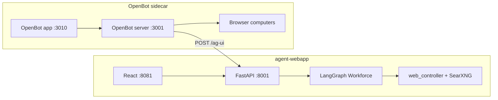

# OpenBot integration (POC)

This repo can act as a **remote AG-UI coworker** for [CopilotKit OpenBot](https://github.com/CopilotKit/OpenBot). LangGraph Workforce stays the orchestration engine inside the backend; OpenBot adds a separate UI with audit, browser computers, and MCP governance.

## What you get in this POC

| Layer | Behavior |
| --- | --- |
| **Your React app (:8081)** | Unchanged — jobs, Workforce, artifacts |
| **Backend AG-UI (:8001/ag-ui)** | New — OpenBot sends a user turn; backend runs `web_controller` research and streams an AG-UI answer |
| **OpenBot UI (:3010)** | Separate product — channels, live browser screen, policy/audit |

## What this POC does **not** do yet

- Does not replace your job/artifact pipeline (no DOCX from OpenBot channel in v1).
- Does not forward OpenBot browser tools into the model loop (single-shot research answer only).
- Does not embed OpenBot inside your React app.

## Enable the bridge

Add to `.env` (repo root):

```env
OPENBOT_AGUI_ENABLED=true
OPENBOT_AGUI_TOKEN=change-me-openbot-token
```

Rebuild backend:

```bash
docker compose --env-file .env up -d --build backend
curl http://127.0.0.1:8001/health
```

## Install OpenBot (sidecar)

```bash
chmod +x scripts/setup-openbot.sh
./scripts/setup-openbot.sh
```

Then follow the script output. You still need:

1. **OpenAI (or compatible) key** in OpenBot `.env`
2. **CopilotKit Intelligence** credentials (`npx copilotkit@latest login` …)
3. Matching **`MANAGED_AGENT_TOKEN`** / **`OPENBOT_AGUI_TOKEN`** if auth is on

Tenant package: `openbot/tenant/` registers coworker **Webapp Research** → `http://localhost:8001/ag-ui`.

## Architecture



## Expected development trajectory

1. **Now (POC):** OpenBot channel → research answer via existing web stack.
2. **Next:** Tool loop — honor `RunAgentInput.tools` so OpenBot browser/MCP tools work mid-run.
3. **Later:** Artifact handoff — AG-UI custom events or tool results returning DOCX links from Document Agent.
4. **Optional:** Policy/audit patterns ported into your main app without running full OpenBot.

## Troubleshooting

| Symptom | Check |
| --- | --- |
| `404` on `/health` | `OPENBOT_AGUI_ENABLED=true` and backend rebuilt |
| `401` on `/ag-ui` | `Authorization` header matches `OPENBOT_AGUI_TOKEN` |
| OpenBot test connection fails | Backend reachable from OpenBot host (`localhost:8001` vs `host.docker.internal`) |
| Empty answer | SearXNG up, `MODEL_*` env set on backend |
